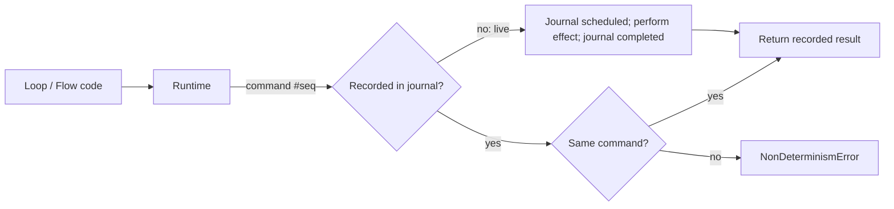
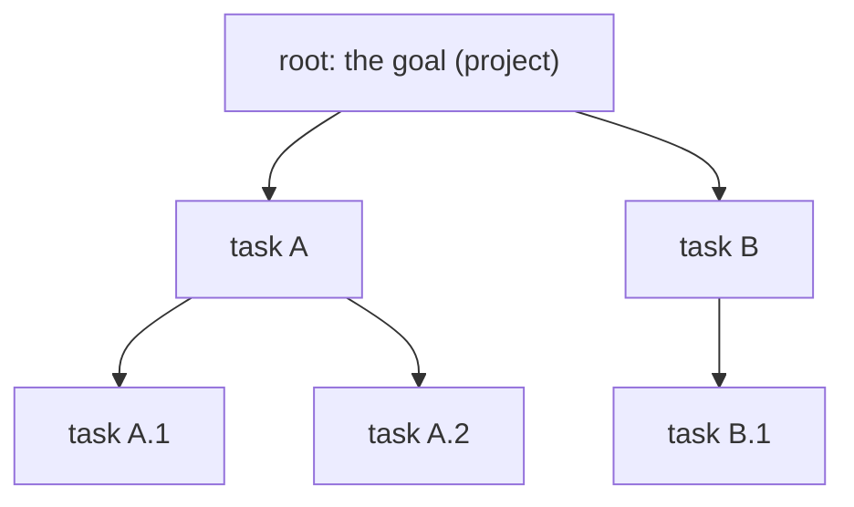
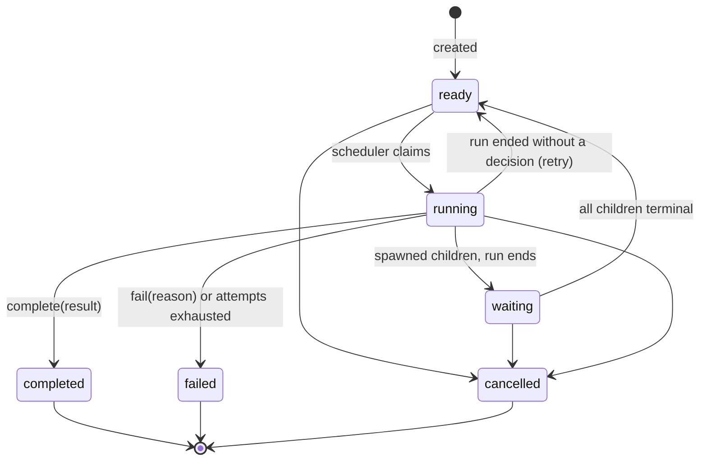

# Durable agent state

Status: phases 1–3 (journal, recovery, determinism, replay, forks and the shared tree)
are implemented in [journal.py](../src/mickro_agent/journal.py),
[runtime.py](../src/mickro_agent/runtime.py), [agent.py](../src/mickro_agent/agent.py)
and [shared.py](../src/mickro_agent/shared.py); the rest is design. Scope: the Python
package (`src/mickro_agent`).
The Rust crate follows later against the same storage schema.

## 1. Goals

1. **Durable execution.** A run that crashes resumes where it stopped. It does not
   repeat model calls or tool effects whose results are already recorded.
2. **Replay.** Rebuild the exact state of any run at any step: inspect it, or fork
   from it with a different provider, prompt or tools.
3. **Shared global state.** Many agents read and write one JSON-like tree, with
   mandatory path locks, read-version tracking and references (refs) between
   entities. Replay sees the shared state exactly as it was at the time.
4. **Portable storage.** SQLite on one host now. Postgres, DynamoDB or S3 later as a
   new backend, without changing Runtime, loops or tools.
5. **Long projects.** Many agents work on one goal, broken into a tree of tasks, for
   weeks. If the process or orchestration fails, `project.resume()` continues the
   project (sections 9 and 10).

### Target workload

| Dimension | Target |
|---|---|
| Active agents (concurrent runs) | a few hundred |
| Tasks per project | thousands |
| Project duration | weeks |
| Hosts | one, with database backups to S3 |

Consequences for the design:

- Everything runs in **one supervisor process**.
- **One committer** batches all journal and shared-state writes (section 7).
- Runs are **short and bounded**: one run per task activation.
- Locks and claims live as long as their **run's lease** (section 6.3).
- The real bottleneck is provider rate limits, so the supervisor controls **admission**
  (section 10.2).

### Non-goals (for now)

- Multi-host workers. On a host failure, you resume on another host from a backup.
- Read locks (`S`) and intention locks in the lock API (section 6.3).
- Migrating Python journals to Rust.
- Replacing the existing JSONL event log, which stays as an observability export.

## 2. Model

This design borrows Temporal's execution model:

| Temporal | mickro-agent |
|---|---|
| Workflow code (must be deterministic) | `Loop` / `Flow` nodes |
| Activities (side effects) | model calls, tool calls, shared-state operations, time, randomness |
| Event history | **journal** (new, section 4) |
| Workflow ID / Run ID | `session_id` / `run_id` |
| Continue-as-new | the next `Agent.run` on the same session |
| Child workflow | `agent_tool` / `AgentJobs` child session |
| Signals | durable per-session **inbox** (new, section 8) |
| `workflow.patched` | `runtime.version(...)` |

Every source of nondeterminism already goes through `Runtime`: `Runtime._request` and
`Runtime._execute_tools` in [runtime.py](../src/mickro_agent/runtime.py). The journal
is placed at that boundary. Loop code is unchanged, and its state (`run.state`,
`run.messages`, local variables) is **never serialized**. State is the result of
re-running the code over the journal.



### The determinism rule

> Loop and node code may do nondeterministic things only through `runtime`.

That rules out `time.time()`, `uuid4()`, `random`, reading files or the network, and
reading mutable globals from loop or node code. Tools are exempt, because a tool call
is itself an effect whose result is recorded.

## 3. Relation to existing code

| Existing | After this design |
|---|---|
| `Session` checkpoint ([sessions.py](../src/mickro_agent/sessions.py)) | A cache derived from the journal; no longer the source of truth |
| `SessionStore.lock` (`fcntl`) | Replaced by run ownership with an epoch (section 4.4) |
| `SessionLog` JSONL ([session_log.py](../src/mickro_agent/session_log.py)) | Kept as an observability export (chunks, timings) |
| `_checkpoint_messages` "Outcome unknown" ([agent.py](../src/mickro_agent/agent.py)) | Becomes the `unsafe` tool rule (section 4.3) |
| `previous.status == "running"` refusal | `Agent.recover(session_id, ...)` |
| `AgentJobs` in-memory mailbox ([agent_tools.py](../src/mickro_agent/agent_tools.py)) | Durable inbox and child reattachment (section 8) |

## 4. Journal

### 4.1 Entries

Entries are keyed by `(session_id, run_id, seq, phase)`. `seq` is a counter that
advances only on Runtime commands; each command has a `scheduled` and a `completed`
row. Observability events (`model_chunk`, `step`) do not advance it.

A run's start and outcome are not journal rows. They live on the run's record in the
`runs` table (section 11.2):

- `start`: fingerprint, limits, input messages, log path, parent links.
- `result`: status, output, error, usage.

The run's final status and its session checkpoint are committed in **one
transaction**, so the checkpoint can never lag behind the run.

| Kind | Payload | Written |
|---|---|---|
| `model_scheduled` | `request_hash`, purpose | before the provider call |
| `model_completed` | `ModelResponse`, usage | after the call |
| `tool_scheduled` | `call_id`, name, `args_hash`, effect kind | before invoking, in provider order |
| `tool_completed` | tool `Message`, `synthetic: bool` | after invoking |
| `side_effect` | `kind` (`now`, `uuid`, `random`), value | on first execution |
| `version_marker` | `change_id`, version | on first execution |
| `shared_read` (completed) | path, value, version, offset (ref-slot versions in phase 6) | each `runtime.shared.get` |
| `shared_write` (completed) | result: committed offset, or rejection | each shared write, in the **same transaction** as its log entry |
| `timer_started` / `timer_fired` | `fire_at` | `runtime.sleep` |
| `signal_received` | inbox id, name, payload | `runtime.wait_signal` |
| `child_started` / `child_completed` | child `session_id` and `run_id`, result | delegation |
| `compaction_applied` | range, replacement messages | on success (the summary itself is a `model_*` pair) |

Implemented: `model_*` and `tool_*` (phase 1); `side_effect` and `version` (phase 2);
`shared_read` and `shared_write` (phase 3). Compaction needs no entry of its own,
because the summary is a journaled model call and applying it is deterministic.

A shared write has no `scheduled` row. Its `op_id` is `session:run:seq`, which is
deterministic, so a crash before the commit simply commits it on recovery, and a crash
after it is deduplicated. The `completed` row is written atomically with the log
entry. It is also written for a **rejection**, which therefore replays as the same
`StaleRead` or `PatchConflict`.

`request_hash` is `sha256` of canonical JSON over `messages`, `tools` and `purpose`.
`run_id` is excluded so that a fork can match its parent's prefix.

### 4.2 Replay rules

On each command, `Runtime` asks the journal for the next entry:

- **Recorded and matching** (same kind, `request_hash`, tool name and `args_hash`,
  `op_id`): return the recorded result. Nothing reaches the provider, tool or store.
- **Recorded but different:** raise `NonDeterminismError(seq, expected, actual)`.
- **Not recorded:** in live or recovery mode, run it live. In inspection mode, raise
  `ReplayExhausted`.

**Parallel tools.** `tool_scheduled` sequence numbers are allocated in the provider's
order before the `TaskGroup` starts. Results are matched by `call_id`, never by the
order they complete in.

**Streaming.** Recorded responses are returned without chunks by default. Pass
`replay_chunks=True` to emit recorded chunks to a UI.

### 4.3 Effects and recovery

A crash can leave a `*_scheduled` entry with no matching `*_completed` entry.

| Command | On recovery |
|---|---|
| Model call | Call again. The cost is tokens; usage is charged again. |
| Tool `effect="read"` | Execute again. |
| Tool `effect="idempotent"` | Execute again with the same `idempotency_key`. |
| Tool `effect="unsafe"` (the default) | Do not execute. Journal a synthetic error result: *"Execution interrupted. Outcome unknown; inspect external state before retrying."* |
| Shared op | Send again with the same `op_id`. The store deduplicates it and returns the original result. |

```python
@tool(effect="idempotent")
def charge(amount: int, idempotency_key: Hidden[str]) -> str: ...
```

`idempotency_key = f"{session_id}:{run_id}:{seq}:{call_id}"`. It is injected like any
`Hidden` value and is stable across crashes and replays.

**Shared ops inside a tool** go through `shared: Hidden[ToolShared]`. They are not
journaled separately, because the tool's result is. Their `op_id` is
`f"{idempotency_key}:{n}"`, where `n` is a counter for that call. Re-executing an
idempotent tool therefore deduplicates its writes, as long as the tool issues them in
the same order.

### 4.4 Run ownership

Fencing on the journal's primary key alone would detect a second writer only when it
appends, which may be after it has already performed a live effect. Each run therefore
has an owner and an **epoch**:

- `recover()` atomically increments `owner_epoch` and sets `owner` and
  `lease_expires_at`.
- Every journal append is conditional on `owner_epoch` being unchanged. A process with
  an older epoch fails its next append and stops before its next effect.
- A heartbeat renews `lease_expires_at` every `lease_ttl / 3` while the run is active
  (`Agent(lease_ttl=30)` by default). Recovery of a run whose lease is still valid is
  refused with `RunLeaseHeld`, unless `force=True` or the claimant is the same owner.
- On a single host, `Worker(store, agents).recover_all(force=True)` at startup is safe:
  no other process can hold these runs, so there's no need to wait for leases to expire.
- A stale owner fails with `RunOwnershipLost`. It neither finishes the run nor writes
  its session checkpoint.
- A `NonDeterminismError` during recovery leaves the run `running`. It can be recovered
  again once the code matches the journal (fix the code, or drain before upgrading).

### 4.5 Time limits

`Limits.timeout` budgets **active execution time**. The heartbeat and the final write
record `active_seconds` on the run, and a recovered run gets
`timeout - active_seconds`. Downtime between a crash and recovery does not count,
which matters when a host is down for hours during a weeks-long project.
`Limits.tool_timeout` applies to each attempt.

### 4.6 Determinism APIs

```python
runtime.now() -> datetime          # journaled (phase 2)
runtime.uuid() -> str              # journaled (phase 2)
runtime.random() -> float          # journaled (phase 2)
runtime.version("change-id", min_supported=0, max_version=1) -> int   # phase 2
await runtime.sleep(seconds)       # durable timer (phase 7)
await runtime.wait_signal(name, timeout=None)                         # phase 7
```

**Side effects.** `now`, `uuid` and `random` are commands with a number, like
Temporal's `SideEffect`. They are synchronous, so sync nodes can use them too. Their
journal row is queued without waiting. The committer writes in submission order, so a
later effect that depends on the value (a model call, a tool) can only be durable if
the value is.

**`runtime.version`** works like Temporal's `patched` / `getVersion`.

- A new execution records and returns `max_version`.
- A replay returns the recorded version.
- A replay of history recorded **before the change existed** returns **0**, meaning
  "the code as it was before any `version()` call". This applies when the call is
  reached while recorded commands are still ahead.
- When the returned version is outside `min_supported..max_version`, it raises
  `VersionUnsupported`, a `NonDeterminismError`, and the run stays recoverable. Raise
  `min_supported` once journals with older versions no longer need to replay.
- Markers are stored by change ID and **use no command number**. Adding a `version()`
  call therefore never shifts later commands. Each marker records `at_seq`, so a fork
  copies only the markers of its prefix.

```python
if runtime.version("double-check") == 1:
    runtime.say("Double-check your work.")      # new code path
```

### 4.7 Fingerprint

`start.fingerprint` (on the run record) holds a separate hash per part, so an error can
name what changed:

- the agent name,
- the loop's qualified name,
- the `Flow` topology (nodes and edges, via `to_flow()` when available),
- the tool specs,
- the system prompt,
- provider type and model name.

When a part differs, **recovery** raises `ConfigurationChanged(changed=("provider",))`
unless `allow_fingerprint_change=True`. The agent name and system prompt must always
match, because the session belongs to them.

Allowing a change helps only when the recorded commands still match. Tool specs and
the system prompt are part of every model request's hash, so changing them makes
recovery raise `NonDeterminismError` at the first model call. Changing the provider or
the model, or loop internals behind `version()`, does not.

**Inspection** replay does not check the fingerprint; divergence shows up as
`NonDeterminismError`. A **fork** records its own fingerprint.

## 5. Replay modes

| Mode | API | Live effects | Prefix check |
|---|---|---|---|
| Recovery | `await agent.recover(session_id, context=...)` | after the end of the journal | strict (kind and key) |
| Inspection | `await agent.replay(session_id, run_id, until_seq=N)` | none | strict |
| Fork | `await replace(agent, ...).fork(session_id, run_id, at_seq=N)` | after command N | lenient up to N (kind only), strict after |

**Recovery.** It needs `context` again, because live resources are never journaled.
`Worker(store, agents).recover_all()` resumes every run in the `running` state on
startup.

**Inspection** returns `Replay(run, commands, reason, pending_tool_calls)`:

- It never writes, and never calls a provider or tool.
- `run` holds the messages, `state`, usage and events after `commands` commands.
- `reason` is `finished` (the loop ended), `until_seq` (the requested step), or
  `end_of_journal` (the next command was never recorded, e.g. an interrupted run).
- A parallel tool batch is replayed whole: an `until_seq` that falls inside a batch
  stops before it.
- A replayed failure, such as a limit or an error raised by a node, becomes part of
  the inspected state.
- Shared reads return what the run read, not today's value. Each recorded read
  carries the world `offset` it saw, and `world.at(offset)` rebuilds the whole world as
  of that moment.

**Fork.** Call it on an agent with the configuration to try, e.g.
`replace(agent, provider=other, system_prompt=...)`.

- The fork gets a **new session** (`new_session_id` or a fresh ID) and a run record
  with `start.forked_from = {session_id, run_id, at_seq}`.
- Its first `at_seq` commands, and the version markers decided within them, are
  copied into its own journal atomically with its creation.
- The prefix is matched **by position and kind only**, so a changed system prompt or
  tool set does not invalidate the recorded results.
- After the prefix it runs live and logs a `fork_live` event.
- A fork is an ordinary durable run: it can be recovered (still lenient up to
  `at_seq`), replayed and forked again. `at_seq=0` reruns from the original input.

## 6. Shared state

### 6.1 Data model

There is one JSON tree per **world** (a namespace; usually one per deployment).

- **Paths** are JSON Pointers (RFC 6901), e.g. `/tasks/t42/status`. Dotted shorthand
  (`"tasks.t42.status"`) is accepted as input only when no key contains `.` or `/`.
- **Writes** are JSON Patch operations (RFC 6902): `add`, `replace`, `remove` and
  `test`. `move` and `copy` are excluded in v1 because they complicate refs.
- **Extension ops:** `lock`, `unlock`, `renew`, `append`, `ref`, `wrap`,
  `create_entity` and `delete_entity`.
- **Storage** is an append-only **log** of committed entries with a gap-free global
  `offset`, plus periodic **snapshots**. The materialized tree is always
  `snapshot(≤ N) + log entries up to N`, so **any offset can be rebuilt** (time
  travel).

```json
{"offset": 125, "committed_at": "2026-11-22T10:00:03Z",
 "author": {"session": "researcher-7", "run": "r1", "seq": 14}, "op_id": "...",
 "based_on": [{"path": "/plan", "version": 117}],
 "ops": [{"op": "replace", "path": "/e/t42/status", "value": "in_progress", "fence": 121}]}
```

`committed_at` is `max(now, previous committed_at)`, so it never goes backwards.

### 6.2 Versions and reads

Each node has two version numbers, both log offsets:

- `own_version`: the last write at exactly this path.
- `subtree_version`: the last write at or below this path. Each write bumps the
  written path and all its ancestors.

`get` returns `Versioned(path, value, version, offset, exists)`, where `version` is the
larger of `subtree_version(p)` and every ancestor's `own_version`: the offset of the
last write that affected `p`. A `based_on` read is **stale** when that number has
changed. A write is never undone, so a change is always an increase in practice.

The rules, each with a test:

| Write after reading `p` | Stale? |
|---|---|
| a sibling of `p` | no |
| `p` itself, or anything below it | yes |
| an ancestor of `p` (replace or remove) | yes |
| creating `p`, directly or by adding an ancestor, after reading it as missing | yes |
| anything inside an array that contains `p` | yes: **an array is versioned as one unit**, because inserting shifts every later index |
| a `test` op | no: `test` writes nothing |

A replaced or removed path's version node is kept, not pruned. Otherwise its version
would fall back to an older ancestor's and could equal an old read.

Every `runtime.shared.get` is journaled as `shared_read`, so replay returns what the
agent actually saw.

**Patch semantics (implemented):**

- RFC 6902 `add`, `remove`, `replace` and `test`, including array insert and `-`
  (append).
- A patch is atomic: if any op fails, nothing changes, and no offset is used.
- `test` uses JSON equality, so `1` is not `true` and key order doesn't matter.
- A malformed patch raises `InvalidPatch` before anything is journaled: an unknown op,
  a missing value, a non-JSON value, more than 100 ops, or more than 256 KB.
- A missing path or a failed `test` raises `PatchConflict`; a changed `based_on` read
  raises `StaleRead`. Both are rejections, which are journaled.
- `world.patch(ops, op_id=...)` makes a write outside a run idempotent.

States are immutable. Each write copies only the containers along its path, so a
rejected patch changes nothing, readers never see half a batch, and time travel
rebuilds a world cheaply.

**Optimistic writes.** These are opt-in per write:

```python
plan = await runtime.shared.get("/plan")
await runtime.shared.patch(ops, based_on=[plan])   # StaleRead if /plan changed since
```

**Provenance.** `based_on` is stored in the log entry. You can query which writes were
derived from a version that has since been superseded. Later, a session can subscribe
to be signalled when an input it read changes (section 8).

### 6.3 Locks

**Semantics.** Locks are exclusive only. Two locks conflict when their canonical paths
are equal or one is a prefix of the other (segment by segment), and their owners
differ. A run may nest locks it already covers.

This is equivalent to multiple granularity locking (Gray et al., 1975) restricted to
`X`. It is computed as a prefix check against the materialized lock table, so no
intention locks are needed. A backend that must check atomically per item, such as
native DynamoDB, can store intention counters instead (section 11.3). The semantics stay
the same.

**Mandatory.** A write whose canonical path conflicts with another owner's live lock is
rejected with `Locked(path, holder)`. A write covered by the writer's own lock must
carry that lock's fence. The runtime adds it automatically for locks held by the run;
`lease=` can pass it explicitly. Writes to unlocked paths need no lock.

**Leases and fencing.**

- `lock` commits a log entry. Its **fence is the offset of that entry**, which is
  strictly increasing.
- **A lock has no lease of its own; it lives as long as its run's lease** (section 4.4).
  The supervisor sends one heartbeat per run to the `runs` table, not one per lock, so
  the shared log has no renewal ops. A lock is valid while its owning run is `running`
  and that run's `lease_expires_at` has not passed when the commit is validated.
  - Trade-off: rebuilding *lock expiry* at a past offset is approximate, because leases
    live outside the log. Lock *grants and releases* are still in the log.
- Safety does not depend on clocks. A stale holder's write carries an old fence or an
  old run epoch and is rejected at commit time, because commits are totally ordered.
  Clock skew can only delay when an expired lease is taken over.

**Scope: run-scoped only.** Locks are released when the run finishes. On a crash they
survive until the run's lease expires. A recovered run claims the run again (a new
epoch, before the lease expires) and **reattaches** to its locks with the same fences.

**Ownership across runs is data, not a lock** (a claim):

```python
async with runtime.shared.lock("/e/t42", ttl=60):
    task = await runtime.shared.get("/e/t42")
    if task.value["owner"] is None:
        await runtime.shared.patch([{"op": "replace", "path": "/e/t42/owner",
            "value": {"session": runtime.run.session_id, "since": runtime.now().isoformat()}}])
```

**Deadlocks.** v1 has no global wait-for graph. It provides:

- `lock_many(paths)`, which acquires in sorted canonical order in one commit;
- `try_lock(path, timeout=)`, which returns `Busy` instead of blocking forever, so the
  model can decide what to do;
- `lock(path, wait=True)`, which parks the run as a durable wait (section 8) until the
  lock is free or the timeout passes.

**Reducer paths.** `world.declare("/findings", reducer="append")` declares an
append-only path. `append` ops on it commute and are exempt from lock checks. Other ops
on it are rejected. v1 reducers are `append`, `counter`, `set_union` and `merge_dict`.

### 6.4 Entities and refs

The goal is that subtrees can be given a stable identity and referenced from many
places. Prior art: Falcor JSON Graph references, normalized GraphQL caches, Automerge
object IDs.

- **Entities** live at `/e/<id>`. An entity root is always an object, never a ref.
- A **ref** is a value whose only key is `"$ref"`: `{"$ref": "/e/t42"}`. A ref may
  target **only an entity root that exists**. Storing a literal object whose only key is
  `"$ref"` as data is rejected.
- `wrap(path)` moves the subtree at `path` to `/e/<new id>` and leaves a ref at `path`.
  Readers of the old path keep working.

```
before:  /projects/alpha/tasks/0 = {"title": "...", "status": "open"}
wrap  →  /e/t42                  = {"title": "...", "status": "open"}
         /projects/alpha/tasks/0 = {"$ref": "/e/t42"}
```

**Resolution uses symlink semantics:**

| Operation | Rule |
|---|---|
| Path traversal | refs in **intermediate** segments are always followed |
| `remove`, `replace` or `ref` on a path ending in a ref | acts on the **ref slot**, not the target, like `rm` on a symlink |
| `get` on a path ending in a ref | returns `{"$ref": ...}` unless `resolve="shallow"` |

Each ref jump consumes a path segment, and entity roots cannot be refs, so resolution
always terminates. Cycles between entities are allowed, since this is graph data.

**Canonical paths.** Every check uses the resolved canonical path: locks, permissions,
`based_on` and staleness. Resolution is journaled with the version of each ref slot it
passed through, so replay resolves to the same entity even after a repoint.

**Ref-slot guards.** Locking or writing through `/agents/r/current` takes an internal
**guard** on that slot for the lease. Guards are compatible with each other. A guard
conflicts with another owner's `X` lock on the slot or an ancestor, and with any
`ref`, `replace` or `remove` of the slot. Without guards, another agent could repoint
`current` from `t42` to `t43` while you work "inside" it.

**Integrity.** The materialized state keeps `backrefs(entity_id → from_paths)`.
`delete_entity` is rejected while inbound refs exist unless `cascade="unlink"`. Cascades
and `wrap` count toward the commit size limit (section 11.1).

### 6.5 API

Implemented in phase 3:

```python
world = SharedWorld(store, name="default", snapshot_every=1000)
agent = Agent(..., store=store, shared=world)    # the world must live in the agent's store

v = await runtime.shared.get("/plan")            # journaled read
await runtime.shared.patch(ops, based_on=[v])    # journaled write; StaleRead / PatchConflict
world.read(path); world.at(offset); world.log(after=0); world.refresh()
await world.patch(ops, based_on=..., op_id=...)  # outside a run, e.g. a supervisor
```

Planned (phases 4–7):

```python
world = SharedWorld(backend, name="default")
agent = Agent(..., shared=world, shared_policy=Policy(read=["/"], write=["/e", "/agents/researcher"]))

v = await runtime.shared.get("/agents/researcher/current", resolve="shallow")
await runtime.shared.patch(ops, based_on=[v])
async with runtime.shared.lock("/agents/researcher/current/status", ttl=120) as lease: ...
await runtime.shared.append("/findings", {...})
tid = await runtime.shared.wrap("/projects/alpha/tasks/0")
await runtime.shared.ref("/agents/researcher/current", tid)
await runtime.shared.wait("/plan", after=v.version, timeout=300)
```

### 6.6 Model-facing tools

`SHARED_TOOLS`: `shared_get`, `shared_list`, `shared_patch`, `shared_append`,
`shared_lock`, `shared_unlock`, `shared_link(path, entity_id)` and
`shared_unlink(path)`.

- Permissions come from `shared_policy` and are checked on **canonical** paths. Creating
  or repointing a ref needs write access to the slot **and** read access to the target.
- Locks taken through tools are released at the end of the run.
- `wrap` and `delete_entity` are not exposed to the model in v1.

## 7. Commit protocol

Every backend commits the same way. Locks, refs, versions, `based_on` and permissions
are **pure Python**, evaluated against a materialized state cached in memory.

1. Bring the cache to `head`: load the latest snapshot once, then read log entries
   after the cached offset.
2. If `op_id` was already committed, return the recorded result (deduplication).
3. Validate the ops in memory: permissions, mandatory locks and fences, guards,
   `based_on`, ref rules, reducer rules and size limits.
   - **Rejected:** do not touch the log. Return the rejection, which the agent journal
     records as the `shared_completed` result, so it replays deterministically.
4. Append the entry at `head + 1`, **conditional on head being unchanged**. In SQLite,
   the shared entry and the agent's `shared_completed` journal entry are written in the
   same transaction.
5. If the condition fails, go back to step 1 (bounded retries, then `Contention`).

**Group commit (v1).** In the single supervisor process, one **committer task** owns
all writes. Agents put journal entries and shared ops on its queue and await a future.

- The committer takes a batch (up to N items or T ms) and validates shared ops **in
  order** against the in-memory state, so a later op in the batch sees earlier ones.
- It writes the whole batch (log entries, journal entries, `head`) in **one SQLite
  transaction**, then resolves the futures.
- With one writer, step 4 never conflicts. The conditional append remains as a guard
  against a second process opening the file.
- At a few hundred agents, this keeps write load to a few transactions per second,
  however many agents there are.

**As implemented (phase 3):**

- A shared commit is an operation in the same committer as journal writes. It is
  applied inside the write batch:
  1. check the run's epoch, so **a stale owner cannot write shared state**;
  2. catch the cached state up to `head` from the log, in case another process wrote;
  3. deduplicate by `op_id`;
  4. validate `based_on` and apply the patch;
  5. insert the log entry and update `head`, plus a snapshot every `snapshot_every`
     entries;
  6. insert the run's `shared_write` row;
  7. stage the new state.
- Staged states become visible to readers only after the transaction commits.
- Validation runs in commit order against staged states, so 50 concurrent
  compare-and-swap writers are serialized correctly and lose no update.

## 8. Signals, timers, waits and children

- **Inbox:** each session has a durable inbox (`inbox` table). Senders call
  `store.signal(session_id, name, payload)`. `runtime.wait_signal(name)` consumes the
  oldest matching unconsumed message and journals `signal_received` with its inbox id.
  Replay returns the same message.
- **Timers:** `runtime.sleep(d)` journals `timer_started(fire_at)`. A recovered run
  waits only the remaining time. On one host, a run must be active to wake up;
  `recover_all()` on startup covers restarts.
- **Durable waits** (`shared.wait`, `lock(wait=True)`): polling the shared head, behind
  a `Notifier` interface. SQLite polls; Postgres would use `LISTEN/NOTIFY`. The result
  is journaled.
- **Children:** the child `session_id` comes from `runtime.uuid()`. `child_started` is
  journaled **before** the child is launched. On recovery the parent **reattaches**:
  if the child's run exists, the parent awaits or recovers it instead of spawning a new
  one. `child_completed` records the result. `AgentJobs` completions are delivered as
  inbox signals, replacing the in-memory `asyncio.Queue`.

## 9. Projects and task trees

### 9.1 Model

A **project** is one goal. The goal is the **root task**. Any task's agent may create
**child tasks**, so the work forms a tree. **The project is complete when the root task
is completed**, and a task can complete only when all its children are terminal.



**A task is a session; each activation is a run.**

- `session_id = task_id`. The task keeps one conversation across activations, with
  compaction applied as usual.
- An **activation** is one bounded `Agent.run` on that session, with a prompt
  describing why it was activated (section 9.3).
- A task waiting for its children holds **no run, no memory and no locks**. Its
  `waiting` status on the board is all that exists.

This is what makes weeks-long projects resumable. The durable state of the project is
the **board** (the tasks in the shared tree). Journals only make in-flight runs
efficient to recover. If a run's journal can't be replayed, for example after a code
change, the task is activated again from the board and its session history.

### 9.2 Task entity

Tasks are entities at `/e/<task_id>`, indexed per project at
`/projects/<project_id>/tasks/<task_id>` (a ref).

```json
{
  "kind": "task", "project": "p1", "parent": "t_root", "depth": 1,
  "agent": "researcher",
  "goal": "...", "acceptance": "...", "inputs": {},
  "status": "waiting",
  "children": ["t_a1", "t_a2"],
  "claim": {"session": "t_a", "run": "r3", "epoch": 1, "fence": 4411},
  "result": null, "error": null,
  "attempts": 1, "max_attempts": 3,
  "budget": {"tokens": 400000}, "spent": {"tokens": 81233},
  "priority": 0,
  "created_by": {"session": "t_root", "run": "r1", "seq": 9}
}
```

- `agent` names an agent configuration in the project's registry. A parent may choose
  only from agents allowed at that depth.
- `spent` is a counter reducer. Each task's spending also adds to every ancestor's
  `spent`, so budgets can be enforced for a whole subtree.

### 9.3 States



Each `ready` status carries the reason for the next activation:

| Reason | Activation prompt contains |
|---|---|
| `new` | goal, acceptance, inputs |
| `children_done` | each child's result or error |
| `retry` | what happened to the previous run (limit, timeout, crash without recovery) |

Transition rules:

- **Automatic transitions happen in the same commit as their cause.** When a child
  becomes terminal and all its siblings are terminal, the parent moves from `waiting` to
  `ready (children_done)` in the commit that completes the child. The tree can't be left
  half-updated.
- **Failure does not propagate up automatically.** A failed child makes its parent
  `ready (children_done)`. The parent's agent then decides: create replacement tasks,
  complete without that result, or fail. When the root fails, the project fails.
- **Cancellation propagates down.** Cancelling a task cancels its whole subtree, and
  running runs in it are cancelled.
- `complete` is rejected while any child is not terminal.

### 9.4 Task tools

These tools are given to every task run and are bound to that run's own task:

| Tool | Effect |
|---|---|
| `spawn_tasks(tasks=[{agent, goal, acceptance, inputs, budget}])` | Creates children (journaled shared op, so recovery creates no duplicates). Returns their ids. |
| `wait_for_children()` | Moves the task to `waiting` and ends the run. |
| `complete(result)` | Moves the task to `completed`. |
| `fail(reason)` | Moves the task to `failed`. |
| `get_task(id)`, `list_children()` | Read the board. |

Together with `SHARED_TOOLS`, these give task agents both the tree and the rest of the
shared state.

**Coordination style is a policy, not a separate architecture.** A central
orchestrator is a root agent that spawns and reviews. A peer style lets workers spawn
their own subtasks. v1 allows a task to create children **only under itself**, so the
structure always stays a tree. Dependencies between siblings are left for later
(section 13).

### 9.5 Guardrails

LLM-generated trees can grow without limit. Each project sets:

- `max_depth`, `max_children` per task, and `max_tasks` per project;
- a token and cost budget for the root, where each child's budget must fit inside its
  parent's remaining budget;
- `max_attempts` per task;
- limits for every run (`Limits`, per agent configuration).

`spawn_tasks` is rejected with a reason the agent can read when a guardrail would be
exceeded.

## 10. Supervisor and project lifecycle

### 10.1 Scheduler

The supervisor is one process. It runs the committer (section 7), the scheduler and
every run as asyncio tasks.

1. Choose `ready` tasks, ordered by priority, then **deepest first**, then creation
   order. Deepest first finishes subtrees before expanding new ones, which keeps the
   number of open tasks bounded.
2. Wait for **admission** (section 10.2).
3. In one commit: claim the task with the run's epoch and fence, and set it to
   `running`.
4. Start `Agent.run(activation_prompt, session_id=task_id)`.
5. When the run ends without `complete`, `fail` or `wait_for_children`, commit
   `ready (retry)` with `attempts + 1`, or `failed` once attempts are exhausted.

### 10.2 Admission control

- **Concurrency:** `max_active_runs` (for example 200), plus a separate limit per agent
  configuration.
- **Provider limits:** one shared limiter per provider and model for requests and tokens
  per minute. Every model call in every run waits on it.
- **Tools:** an executor pool with limits per kind (for example at most 8 Python
  sandboxes).
- **Budget:** when the project budget is spent, the supervisor **pauses** the project
  instead of failing it.

### 10.3 Lifecycle API

```python
project = await Project.create(store, goal="...", agents={"planner": planner, "researcher": researcher},
                               limits=ProjectLimits(max_depth=5, max_tasks=5000, budget_tokens=500_000_000))
await project.run()        # until the root is terminal

project = Project.open(store, "p1", agents=...)
await project.resume()     # after any crash
await project.pause()      # stop admitting; in-flight runs finish their current activation
await project.drain()      # pause and wait for in-flight runs to end
project.status()           # counts by status, budget, active runs, oldest waiting task
```

### 10.4 `resume()`

1. Open the store and rebuild the shared state from the latest snapshot plus the log
   tail.
2. List runs with status `running`. For each:
   - if the task's claim still names this run: **recover** it (section 5) through
     admission, with orchestrator-level tasks (smaller depth) first;
   - otherwise: mark the run as abandoned.
3. Return tasks whose claims point at abandoned or unrecoverable runs to `ready (retry)`.
4. Start the scheduler.

Recovering a run means replaying its journal, so it repeats no model call or tool
effect that was recorded. A run that can't be replayed, for example because its
fingerprint changed, is abandoned, and its task is retried from the board.

### 10.5 Upgrades during a project

Runs are short, so code changes don't need journal compatibility:

1. `drain()`.
2. Deploy.
3. `resume()`.

`runtime.version()` is only needed to upgrade **without** draining.

## 11. Storage

### 11.1 Backend rules

These rules keep a future switch to Postgres, DynamoDB or S3 to one new module:

1. All logic for locks, refs, versions, `based_on` and permissions lives in Python over
   the materialized state. Backends do not contain SQL logic for these.
2. Commits are bounded: at most 256 KB per entry and 100 touched paths. Larger values go
   to a blob store and are stored by reference.
3. Offsets come from a conditional update of a single `head` record. Never use
   auto-increment or sequences, because they can commit out of order.
4. Backrefs, versions and locks are explicit records in the materialized state, never
   derived with joins.
5. Notifications go through `Notifier`, with polling as the fallback.
6. One **conformance test suite** runs against every backend: ordering, deduplication,
   fencing, conflict retries, and crashes between any two steps.

```python
class JournalBackend(Protocol):
    async def create_run(self, run: RunRecord) -> None: ...
    async def claim_run(self, session_id: str, run_id: str, owner: str, ttl: float) -> int: ...   # new epoch
    async def append(self, session_id: str, run_id: str, epoch: int, entries: list[JournalEntry]) -> None: ...
    async def read(self, session_id: str, run_id: str, after_seq: int = -1) -> list[JournalEntry]: ...

class SharedBackend(Protocol):
    async def head(self, world: str) -> int: ...
    async def append(self, world: str, expected_head: int, entry: LogEntry,
                     journal: JournalWrite | None = None) -> int | Conflict: ...
    async def read(self, world: str, after_offset: int, limit: int = 1000) -> list[LogEntry]: ...
    async def find_op(self, world: str, op_id: str) -> LogEntry | None: ...
    async def snapshot(self, world: str, at_or_before: int | None = None) -> Snapshot | None: ...
    async def write_snapshot(self, world: str, snapshot: Snapshot) -> None: ...
```

`journal=` lets a backend that supports it (SQLite, Postgres, DynamoDB) commit the
agent's journal entry atomically with the shared entry. Other backends rely on `op_id`
deduplication.

### 11.2 SQLite (v1)

The journal and the shared state share one file in WAL mode. All writes use
`BEGIN IMMEDIATE`.

Implemented in phase 1 (`PRAGMA user_version = 1`, `synchronous=FULL`):

```sql
CREATE TABLE runs (
  session_id TEXT NOT NULL, run_id TEXT NOT NULL,
  agent TEXT NOT NULL,
  status TEXT NOT NULL,                    -- running | completed | limit | timeout | failed | cancelled
  owner TEXT, epoch INTEGER NOT NULL, lease_expires_at REAL NOT NULL,
  active_seconds REAL NOT NULL,
  start TEXT NOT NULL,                     -- JSON: fingerprint, limits, messages, log path, parents
  result TEXT,                             -- JSON: output, error, usage
  updated_at REAL NOT NULL,
  PRIMARY KEY (session_id, run_id)
);

CREATE TABLE journal (
  session_id TEXT NOT NULL, run_id TEXT NOT NULL, seq INTEGER NOT NULL,
  phase TEXT NOT NULL,                     -- scheduled | completed
  kind TEXT NOT NULL, key TEXT NOT NULL, payload TEXT NOT NULL,  -- JSON
  epoch INTEGER NOT NULL, created_at REAL NOT NULL,
  PRIMARY KEY (session_id, run_id, seq, phase)
);

CREATE TABLE sessions (session_id TEXT PRIMARY KEY, body TEXT NOT NULL);

-- Phase 3 (PRAGMA user_version = 2; a version 1 file gains these tables when opened):
CREATE TABLE shared_head (world TEXT PRIMARY KEY, head INTEGER NOT NULL);

CREATE TABLE shared_log (
  world TEXT NOT NULL, offset INTEGER NOT NULL,
  op_id TEXT NOT NULL, entry TEXT NOT NULL,                  -- JSON (section 6.1)
  PRIMARY KEY (world, offset)
);
CREATE UNIQUE INDEX shared_log_op ON shared_log (world, op_id);

CREATE TABLE shared_snapshots (
  world TEXT NOT NULL, offset INTEGER NOT NULL, body TEXT NOT NULL,  -- JSON: tree + versions (+ locks, backrefs)
  PRIMARY KEY (world, offset)
);
```

Planned for later phases:

```sql
CREATE TABLE inbox (
  session_id TEXT NOT NULL, id INTEGER NOT NULL,
  name TEXT NOT NULL, payload TEXT NOT NULL, sent_at TEXT NOT NULL,
  consumed_run TEXT, consumed_seq INTEGER,
  PRIMARY KEY (session_id, id)
);
```

In v1 the materialized state is the in-memory cache only. Each process rebuilds it from
the latest snapshot plus the log tail, and tails the log afterwards. Snapshots are
written every N entries (default 1,000). Size: the whole tree must fit in memory; that
is acceptable on one host and is revisited for other backends.

`DurableStore` also implements `SessionStore`, so `Agent(store=...)` keeps session
checkpoints in the same file. A completed session continues with `Agent.run` as
before.

**Host durability.** Copy the database file to S3 continuously (WAL streaming, for
example Litestream) or on a schedule. Resuming on another host means: restore the file,
then call `project.resume()`.

### 11.3 Planned backends

- **Postgres** (multi-host). Use the same tables. Keep `head` as a single row updated in
  the commit transaction, not a `bigserial`. Use `LISTEN/NOTIFY` for `Notifier`.
  Optionally, a materialized-nodes table with `ltree` paths, so processes don't hold the
  whole tree.
- **DynamoDB.** The journal is `PK=session#run`, `SK=seq`, written with
  `attribute_not_exists`. The log is `PK=world#segment`, `SK=offset`. `head` is one item
  in the same `TransactWriteItems` as the log entry and the journal entry. Snapshots go
  to S3 with a pointer in DynamoDB. `Notifier` uses Streams or polls `head`.
  - To scale past one `head`, switch to per-item conditions with intention counters on
    ancestors, because queries cannot run inside a transaction.
  - Estimated size of this backend: about 600–1,000 lines plus the conformance suite.
- **S3 (log layout).** Each entry is `log/<offset>` created with `If-None-Match: *`.
  Snapshots go to `snapshots/<offset>`. The journal and the shared log cannot be
  committed atomically, so this backend relies on `op_id` deduplication. Expect about
  10–20 commits per second unless commits are grouped.
- **Never one rewritten `state.json`:** every writer would compete on a single ETag.

## 12. Build plan

Each phase ends with passing tests. Tests use the `scripted` provider so crashes and
replays are deterministic. Phases 1–2 are the durable-run core and come first.

1. **Journal and recovery** (done)
   - Work: `DurableStore` (`MemoryStore` and `SqliteStore`), `runs` with epochs and run
     leases, the group-commit committer, journaling in `_request` and `_execute_tools`,
     tool `effect=`, active-time timeout budget, `Agent.recover`,
     `Worker.recover_all`.
   - Known limit: a delegated `agent_tool` call is an `unsafe` tool. A recovered parent
     gets "outcome unknown" for it, and the child's own run is recovered separately.
     Reattaching to the child is phase 7.
   - Tests: crash at every `seq` of the ReAct, PlanThenAct and ReActWithSummary
     examples. Each recovered run has the same output and messages as an uninterrupted
     run, and the side-effect counter for `unsafe` and `idempotent` tools is correct.
     Plus: 200 concurrent scripted runs, a crash, then `recover_all`.
2. **Determinism, replay and fork** (done)
   - Work: `now`, `uuid`, `random`, `version`; per-part fingerprint and
     `ConfigurationChanged`; `replay(until_seq)`; `fork(at_seq)`.
   - Tests:
     - a crash at every write never changes the recorded side-effect values;
     - `version` keeps old journals replayable, and `min_supported` rejects them;
     - a changed provider is named, and allowing it continues the run;
     - replay at every step performs no write and no effect;
     - a fork with a different provider and system prompt reuses its prefix, diverges
       after it, and can itself be recovered.
3. **Shared tree core** (done)
   - Work: shared tables in both stores (instead of a separate `SharedBackend`, so a
     write and its journal row commit together), log, snapshots, JSON Pointer and
     Patch, versions, journaled reads and writes, `based_on`, provenance (`based_on`
     and author in every log entry), `ToolShared` for tools, the conformance suite.
   - Tests:
     - the conformance suite on memory and SQLite: patch semantics, atomic rejection,
       the staleness table, deduplication, time travel and restart at every offset
       with snapshots, 50 concurrent compare-and-swap writers;
     - a crash at every write gives exactly one increment;
     - a journaled rejection replays;
     - replay returns what the run read;
     - a stale owner cannot write;
     - an idempotent tool's re-execution writes once.
   - Note: a fork writes to the same world as its source, because the world is
     global. Give the forking agent a scratch world to keep experiments out of it:
     `replace(agent, shared=SharedWorld(store, "sandbox"))`.
4. **Locks**
   - Work: mandatory exclusive locks tied to run leases, fences, `lock_many`,
     `try_lock`, reducer paths, `SHARED_TOOLS` (minus refs).
   - Tests: the prefix-conflict matrix, a stale fence or epoch rejected after a lease
     expires, reattachment on recovery.
5. **Projects and task trees**
   - Work: task entities, state machine with transitions in the same commit, task
     tools, guardrails and budgets, scheduler, admission control, `Project` with
     `run`, `resume`, `pause`, `drain` and `status`.
   - Tests:
     - a scripted three-level tree completes;
     - killing the supervisor at random points during a 1,000-task tree and resuming
       ends in the same completed tree, with no duplicate children and no task run
       twice after its result was committed;
     - guardrails reject runaway spawning;
     - the budget pauses the project.
6. **Entities and refs**
   - Work: `wrap`, `ref`, guards, backrefs, cascades, policies on canonical paths,
     `shared_link` and `shared_unlink`.
   - Tests: an alias cannot bypass a lock or policy, repoint during a lease is rejected,
     deleting an entity with backrefs is rejected.
7. **Signals, timers and children**
   - Work: inbox, `wait_signal`, `sleep`, `shared.wait`, `lock(wait=True)`, child
     reattachment, `AgentJobs` on the inbox.
   - Tests: a parent crash while a child runs leads to reattachment with no duplicate
     child, and a signal is consumed exactly once across a crash.
8. **Later:** port to Rust against the same schema (journal `schema_version: 3`), then
   the Postgres backend, then DynamoDB or S3 as needed.

## 13. Open questions

- **Tree size:** when the in-memory materialized tree stops being acceptable, which
  index to add first (Postgres `ltree` nodes, or snapshot paging).
- **Dependencies between siblings:** allow `depends_on` between tasks of the same
  parent (a DAG within a level), or keep strict trees and express ordering through
  the parent.
- **Human input:** a `waiting_for_human` status fed by inbox signals, for approvals
  and questions during weeks-long projects.
- **Session growth:** a task session that is activated many times needs compaction
  or continue-as-new with a summary taken from the board.
- **Tool-internal shared ops:** deduplication relies on the order of writes inside a
  tool. Decide whether to require `effect="idempotent"` tools to name their writes
  explicitly (`op_key=`).
- **Policies:** whether path prefixes are enough, or entity-level ACLs are needed.
- **Journal retention:** archive journals of completed runs after a retention period.
  Inspection and forks of old runs need them; project resume does not.
